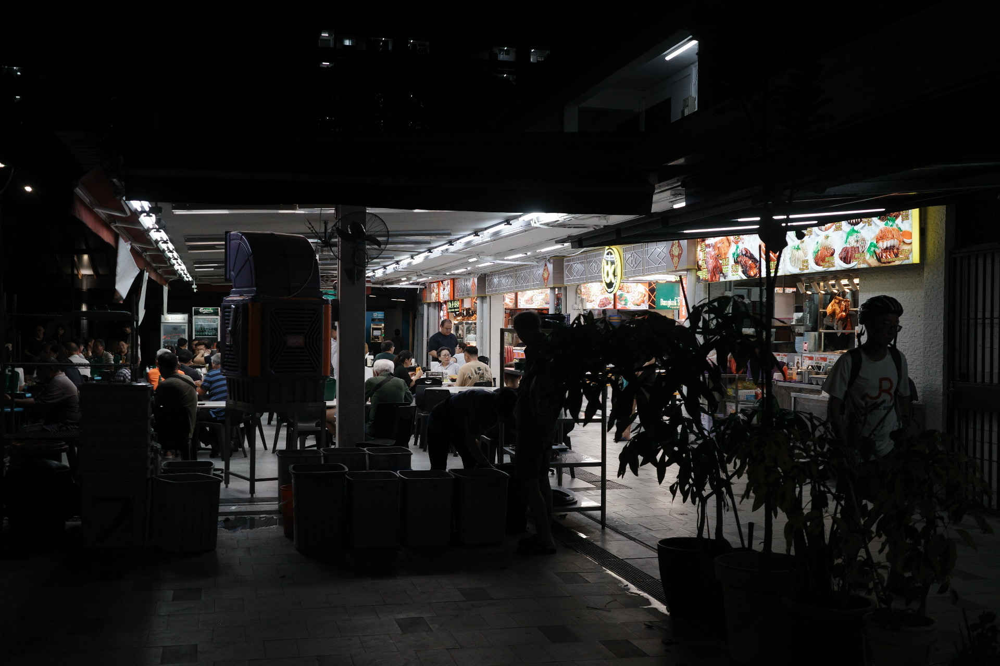

import Rail from '../../components/Rail.astro';
import Media from '../../components/Media.astro';
export const components = {media: Media}
import { getPostImages } from '../../utils/assetImages';
import { Image } from 'astro:assets';
export const images = getPostImages('2026snd');

4月末、同僚とシンガポールに[SND47](https://snd.org/snd47-singapore/)のカンファレンスを聴きに行った。
なぜ今更書くのかというと、膨大な情報量を咀嚼しきれなかったのと、ここ半年の仕事の中でここで聞いたことについて考えることが多かったのでまとめようと思った。

長くなるが、そもそもビジュアルジャーナリズムってなんだ？という話から、このカンファレンスを経て考えたことを書く。

## ビジュアルジャーナリズムってなに
視覚情報を積極的に用いる報道表現・手法が広くそう呼ばれる。私は普段この分野でデザインしたりプログラムしたりしている。テキストのみでは伝えにくい情報をグラフィックス、必要ならばインタラクションも交えて理解を助ける。その中でも以下のような種類がある。

- **データジャーナリズム**
	- オープンデータや統計とそれらの可視化を用いて、データに基づいた物語を語る手法
- **ビジュアルエクスプレーナー**
	- 一連のニュースの背景や仕組みを、図解などを交えて伝えるニュース解説
- **ビジュアルインベスティゲーション**
	- 伝統的な報道手法とともに、SNS映像や衛星画像、公的書類などの視覚的な証拠を収集・分析し、事実を明らかにする調査報道手法。

いずれも紙・デジタルにかかわらず、情報を伝える上で視覚要素の比重が大きいコンテンツである。従来の報道のスキルだけでなく、

- ファクト発掘のためのデータ分析に用いる統計学や機械学習の知識
- 良い読者体験のための情報設計技術
- 伝えるためのデータ可視化・グラフィックデザインスキル
- Webページを実装するWebフロントエンド技術

などチームには複合的なスキルセットが求められる。

## Society for News Designとは

Society for News Design（SND）は、報道機関のデザイン・イラスト・インフォグラフィック等の専門家のための非営利団体。要は報道機関で働くデザイナーやイラストレーターのコミュニティである。

> 世界最高水準のビジュアルジャーナリズムを創造、制作、促進、教育しています。  当協会は、以下のことを目指しています。
> - すべての職種において最高水準の倫理基準を促進する
> - ビジュアルジャーナリズムを不可欠な学問分野として擁護する
> - ジャーナリストを継続的に教育する
> - ジャーナリズムのあらゆる側面における卓越性を称える
> - 業界全体でイノベーションを奨励する
> - 問題について批判的な検討と議論を行うためのフォーラムを提供する
> - 当協会のユニークで多様な国際的かつ多文化的な特性を尊重する。

出典：[Society for News Design](https://snd.org/about-us/our-mission-and-code-of-ethics/)

歴史は古く、1979年に設立されて以来毎年、世界中の新聞やWebメディアにおけるビジュアルストーリーテリングやインフォグラフィックスをはじめ、昨今のインタラクティブビジュアルストーリーを用いたより良いジャーナリズムのあり方について議論し、年一で優れたコンテンツやチームを表彰する [コンペティション](https://snd.org/best-of-design-competitions/) やカンファレンスを開催している。

## 今年のコンペ受賞作
百聞は一見にしかず。今年のコンペティションの受賞作で私が個人的に気に入ったコンテンツをいくつか紹介する。

### The Straits Times

<Rail size="m" space={false}>
	")
</Rail>

シンガポールの新聞社The Straits Timesの、シンガポールの騒音について調査し、伝えるエクスプレーナー。周波数とデシベル値を組み合わせた独自の可視化表現を用いることで視覚的なインパクトを持たせている。

### South China Morning Post

<Rail size="m" space={false}>
	")
</Rail>

香港の英字新聞サウスチャイナモーニングポストが、広島平和記念日に合わせて公開したコンテンツ。実際の紙にスタンプで原爆犠牲者の数を可視化、その紙を大きな鶴に折って哀悼とする、情緒を煽るアナログ仕事の光るコンテンツ。

### ABC News

<Rail size="m" space={false}>
	")
</Rail>

米国ABC Newsのコンテンツ。テックサービスの利用規約とプライバシーポリシーを実際の紙に印刷して壁に貼り、それを子供やその親が実際に読み理解することが如何に困難か伝えるコンテンツ。実物に出力することでファクトのインパクトがより大きくなる。

### The Washington Post

<Rail size="m" space={false}>
	")
</Rail>

米国ワシントンポストのコンテンツ。ガザで亡くなった未成年の名前をただひたすらに列挙する。その数によるスクロールの長さがそのまま重みとなって伝わるコンテンツ。個人的に昨年最も印象に残った。

### 特徴
このようにビジュアルジャーナリズムコンテンツは、文章では伝えにくいデータや自分事にしにくい概念を見てすぐに理解できるようにする役割をグラフィックに持たせることで、より深みのある体験を提供する。

今回の受賞作は、デジタル完全完結でなくリアル世界に出力することで出せる説得力を活かす表現が特に印象的だった。

ありがたいことに僕が担当したものもいくつか佳作（Award of excellence）に入選した。所属を知っている人は見てみてほしい。
https://snd.org/results/

## カンファレンスで聞いたこと
報道関連のカンファレンスはファクト発掘のための調査手法やデータ分析、取材活動の話が中心になることが多い。だがこのイベントでは終始「報道のデザイン」の話をしていて新鮮だったし楽しかった。それもビジュアルコンテンツの制作過程や表現の話だけでなく、

- オープンデータの探索
- デザインシステム
- リブランディング
- 組織内での教育・啓蒙活動
- アクセシビリティ
- インスピレーション
- デザイン哲学

などと言った幅広い話題がセッションで取り上げられ、「報道でやるデザイン全部のせ」と言った感じで良かった。

### 創造性の源泉
[Xaquin GV氏](http://xocas.com/)はビジュアルジャーナリスト、講師、コンサルタントであり、データビジュアライゼーション、ビジュアル解説、インタラクティブストーリーテリングの専門家だ。彼のセッションでは、デザイナーやビジュアルジャーナリストが、仕事場以外の場所でインスピレーションと出会うための考え方を語っていた。

> 創造性はどこからか自然に湧くものと誤解されている。そうではなく、自分の専門分野の外に目を向けて、他の分野や学問が自分の抱える問題をどのように解決してきたか気付く能力のことだ。

趣味の領域やWebエンジニアリングからインスピレーションをもらっている自分もこの考えには共感できる。ジャーナリズム領域に限らないクリエイティブの根源的な話をしていたのが印象的で、それを聞いているとグラフィックデザインを学んでいた学生時代の精神性を思い出すものであった。

### 報道の時間軸の中で素早く質の高いコンテンツを作る環境
[サウスチャイナモーニングポスト](https://www.scmp.com/infographic/)は古くからイラストを効果的に用いたビジュアルストーリーに定評があるメディアだ。ここのビジュアルチームではデザイナーも現場に赴き取材をする。現場でスケッチを行い、言語以外の情報を絵として残していく。それらを元に有識者へも取材を行い、正確な情報をイラストとして起こしていくようだ。

インタラクティブなビジュアルコンテンツは親サービスのシステム制約に縛られない独自の開発環境で開発されることが多いが、SCMPの実装環境は印象的だった。

> SCMP Blocksは、SvelteKitをベースとしたアプリケーションで、スタンドアロンのビジュアルストーリーを作成するための再利用可能なコンポーネントのライブラリを提供します。レイアウトは、テキスト、画像、グラフ、地図、動画、インタラクティブ要素などのモジュール式ブロックを使用して、Google Docs上で直接組み立てられます。各ブロックは、Tailwind CSSのユーティリティクラスを使ってカスタマイズ可能です。

<Media 
	src={images['scmp_blocks.jpg']}
	sources={[
		{src: images['scmp_blocks_over480.jpg'], media: "(min-width: 480px)"},
	]}
	alt="SCMP Blocksの概念図"
	caption="プレゼンの内容から推測したシステム概念図" 
/>

GoogleDocs上の原稿が更新されればDraftページは直ちに更新され、原稿と動作チェックを迅速にできる。コンテンツ固有の表現力を保ちながら、実装コードと編集情報を別で管理し、迅速な編集が可能な構成にしているのはスピード感が必要なニュースには有効だと感じた。

### 報道コンテンツに感情を想起させる要素を足す試み
米国の経済誌[Bloomberg](https://www.bloomberg.com/)のビジュアルジャーナリストは、コンテンツを制作していく過程の説明の中で、無機質なデータ可視化表現にそのデータから読み取れる問題がもたらす当事者の困難などの感情を想起させる要素をプラスする試みについて話していた。

> どうすれば読者に物語を伝え、読者を圧倒することなく注意を引きつけ、より深く関わってもらえるのか、という問題に直面することがあります。  
> グラフィックは非常に落ち着いていて、清潔感があり、鮮明なのですが、物語は人々の苦闘、特に終わりが見えない状況での苦闘を描いている。  

> **私はスケールと具体性の間を行き来しているだろうか？**  
> **このページは人々にどのような感情を抱かせるべきだろうか？**  
> **これをよりリアルにするために、何を見せればいいだろうか？**  

## ビジュアルジャーナリズムと感情
当事者の感情を伝えるビジュアル要素として、古くから写真が広く使われている。インタビューや災害報道の写真が想像しやすい。

Bloombergのビジュアルジャーナリストが述べたことは、それとはまた異なる視点であり、挑戦しがいのある課題だった。スケールが大きくてピンと来にくいマクロ経済やビジネスの話、そこで使われるデータセットのさらに先には、経営者、消費者たちのミクロな物語が必ず存在する。そこに人間の感情がある。その感情を想起する要素をデータ可視化表現にプラスして読者に共感を促す試みだ。

しかしそこにはリスクもある。一歩間違えればそれは恣意的になり報道の中立性を損なう恐れがある。語る事実を受け取った側が憶える感情は立場や環境、信条により異なる。それを誘導するような形になってしまうのは適切ではない。丁度良い良い塩梅を見つけるには読者に対する深い理解と多くの経験が必要となるし、作るものを常に客観的に見続ける姿勢が要る。

### 記憶に残るコンテンツ

ジャーナリストと共にに伝えたいことが

- 話の骨子がマクロなのかミクロなのか、それらを行き来をするのか
- 事象のみか、それがもたらす当事者の感情か

これらストーリーの切り口と語り口で変わってくると私は考える。これは報道機関の編集方針でも異なるかもしれない。サービスのトーンを一貫して遵守し淡々と事実をビジュアルで語るメディアもあれば、表現力を最大限駆使して当事者の感情を具体化するビジュアルを作るメディアもある。これらの違いは非常に興味深い。

思えば私が気になった受賞作も当事者の感情を想起させる要素を持っている

- The straits Timesはリアルな生活空間を
- South China Moning Post は紙の鶴を
- ABC Newsは読む気になれない長さの紙を
- The Washginton Postは亡くなった子供たちの名前を....

深く印象に残るストーリーは読者の視点まで降りてきて感情を揺さぶる。印象に残る。優れたジャーナリズムはストーリーテリングが優れていることが前提だが、それを過不足なく伝えて印象に残すにはデザインとグラフィックスが助けになると思っている。たとえ消費期間が短い報道であっても長く心に残るコンテンツを作れたら良い。

## BTW：シンガポールの印象

<Rail size="m">
	
</Rail>

初めて行ったシンガポール。4月の終わりといえどめちゃくちゃ暑かった。すごい蒸す。大して室内のエアコンの設定温度がめちゃくちゃ低くく、温度差で風邪引きそうだった。外に出るだけでメガネが曇る。

シンガポールの景色は他の国とも随分違う印象だった。シンガポールの公用語は英語、中国語、マレー語、タミル語と多く、さまざまな言語で看板や道路表示が書かれており、にぎやかだった。またその国土の都合上、一軒家というものをほとんど見られず、集合住宅が所狭しと並ぶ景色もまた新鮮だった。これは東南アジア共通かもしれないが、ホーカーズと呼ばれる屋台村がいくつもあり、いつも賑わっていた。そしてマーライオンなどがある経済の中心地は綺麗な道路に高層ビルが所狭しと並ぶ、経済大国らしい景色。

これらのどの地域も道は綺麗でゴミ一つなく、住む人々の民度の高さが窺える。シンガポールは夜でも何も心配なく出歩ける数少ない国だとされる。実際人通りも多く、危険な雰囲気はほとんどなかった。総じて過ごしやすい国だと感じた。

食事はどれも美味しかった。特に海鮮と果物。

現地の移動ではタクシーはほとんど捕まらないというので、現地のUberにあたるGrabというサービスで移動した。運転手の方はみんな親切だった。車のダッシュボードにみんな小さい仏壇？が作られていてアジア文化を感じた。

今回の会場になったシンガポールの新聞社The Straits Timesのデザイナーの中に多摩美出身で日本語堪能な方がいて、親切に会場を案内してくれて随分助かった。日本に年一で遊びにきているみたいなのでまた会いたい。

---

シンガポールからの帰りの機内で見たニュルンベルク裁判を題材にした映画「Nuremberg」がとても良かったのだが、どうやら日本では公開してないらしい。サブスクでも日本での配信はなさそうなのでちょっと得をした気分になった。（来年日本公開らしい）
